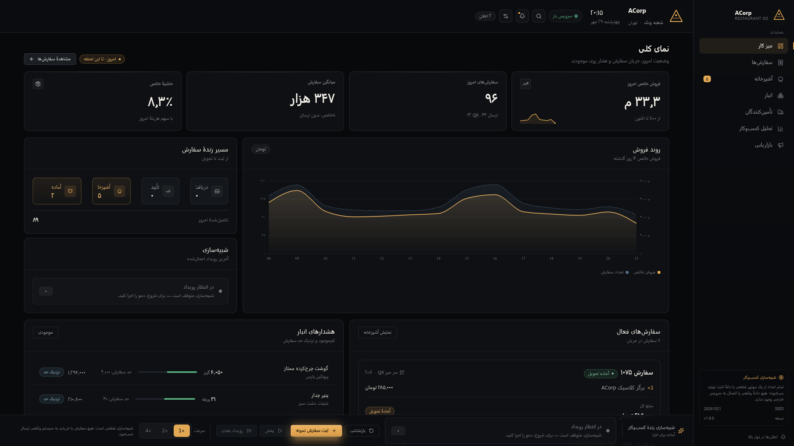
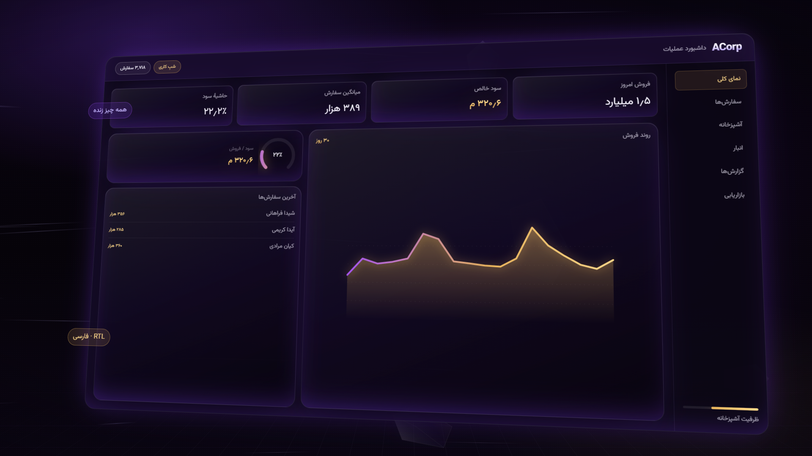

# ACorp — Restaurant Intelligence

A Persian-first (RTL) restaurant operations console, plus a 70-second
cinematic commercial rendered from the same code. Both run on one deterministic
simulation engine: every number on screen is derived from the same event stream,
so the dashboard, the tests and the film can never disagree.

> **Brand:** ACorp (Latin wordmark) · **UI language:** Persian · **Currency:** Toman

**Live dashboard:** <https://acorp-restaurant-dash.darkestjokepossible.workers.dev/>
**Commercial (MP4, 70s):** [download](https://github.com/a-saeedia/acorp-restaurant-dash/releases/download/v2.0.0/acorp-commercial.mp4)

[](https://github.com/a-saeedia/acorp-restaurant-dash/actions/workflows/ci.yml)





---

## What is in here

| Surface                 | Path                            | Stack                      |
| ----------------------- | ------------------------------- | -------------------------- |
| Operations dashboard    | `src/dashboard`                 | React 19, Vite 8, Recharts |
| Simulation engine       | `src/simulation`                | Pure TypeScript, zero deps |
| Shared UI kit           | `src/components` + `src/design` | CSS custom properties      |
| Commercial (70s, 1080p) | `src/video`                     | Remotion 4                 |
| Tests                   | `src/test`                      | Vitest + Testing Library   |

Nine screens: overview, orders, kitchen, inventory, suppliers, analytics,
marketing, notifications, and a global simulation dock that replays the full
11-step order workflow at 20× speed.

---

## Quick start

```bash
pnpm install
pnpm dev            # dashboard on http://localhost:5173
pnpm test           # 34 engine/selector/timeline tests
pnpm build          # typecheck + production bundle into dist/
pnpm demo           # serve dist/ on http://127.0.0.1:4318 (fixed port)
```

Video:

```bash
pnpm audio          # synthesise public/audio/bed.wav (70s, no samples)
pnpm video:stills   # render 10 PNG stills into out/stills/
pnpm video          # Remotion Studio
pnpm video:render   # out/acorp-commercial.mp4 (1920×1080, 30fps, H.264)
```

---

## Determinism

- Fixed demo clock: `2026-10-21T20:15:00+03:30` (Asia/Tehran, no DST).
- Seeded RNG (`SIMULATION_SEED = 20261021`), 365 days of history, 96 orders today.
- The order pipeline is an event log; state is a fold over events, and
  `deriveStateAtFrame(state, events, frame, fps, origin)` makes every film frame
  reproducible from an integer.
- Analytics recompute only on `ANALYTICS_UPDATED` / `ORDER_CANCELLED`, and the
  current service day is prorated by `serviceDayProgress()` rather than assumed
  complete.

Money is stored as integer Toman. No floats touch a currency value.

---

## Persian engineering notes

- `dir="rtl"` on `<html>`, logical CSS properties (`inset-inline`, `margin-inline`)
  everywhere — the layout mirrors without a second stylesheet.
- Jalali dates and Persian digits come from a single `src/lib/fa.ts` module
  (`Intl` based), so the dashboard, exports and video all format identically.
- Vazirmatn variable font is self-hosted (`public/fonts`) — no Google Fonts, no
  network at runtime, no flash of tofu.
- Numerals are tabular in tables and metrics so columns do not jitter.

---

## Deployment

The dashboard is a static SPA served by a **Cloudflare Worker with static
assets** (`wrangler.jsonc`):

```bash
pnpm build
cp out/acorp-commercial.mp4 dist/     # optional: ship the film with the site
pnpm exec wrangler deploy
```

Note: `wrangler pages deploy` will refuse to run here — the repository ships a
Workers config (`assets.directory = ./dist`), which Cloudflare now recommends
over Pages. No server, no database, no secrets. The app bundle is ~710 kB
(209 kB gzip).

---

## Licensing — read this

- **This repository's code:** MIT (see `LICENSE`).
- **Remotion:** Remotion is _source-available_, not OSI open source. It is free
  for individuals and companies with up to 3 employees; companies with 4 or more
  employees need a paid Company License. The commercial in `src/video` therefore
  inherits Remotion's terms. See <https://remotion.dev/license>.
- **Vazirmatn:** SIL Open Font License 1.1.
- **Lucide icons:** ISC. **Recharts:** MIT.

If you fork this and remove Remotion, the rest of the project is unambiguously MIT.

---

## Film script

The narration is data, not code: `src/video/script.ts`. Captions are kinetic
typography because there is no Persian TTS on the build machine — no fake
voice-over, no borrowed audio. The soundtrack in `public/audio/bed.wav` is
synthesised from sine waves and filtered noise by `scripts/generate-audio.mjs`.

| #   | Scene                             | Length |
| --- | --------------------------------- | ------ |
| 1   | Cold open — wordmark            | 6s     |
| 2   | The problem — three leaks       | 8s     |
| 3   | Order flow — 11 events          | 10s    |
| 4   | Kitchen — same instant          | 8s     |
| 5   | Inventory — before it runs out  | 8s     |
| 6   | Analytics — profit, not revenue | 10s    |
| 7   | Marketing — attribution         | 8s     |
| 8   | Product — one screen            | 8s     |
| 9   | Outro                             | 4s     |

Total: **2,100 frames / 70 seconds**.

---

## Repository layout

```
src/
  simulation/   domain: catalog, orders, engine, analytics, selectors
  design/       tokens, base, components, screens (plain CSS)
  components/   shared kit used by dashboard and film
  dashboard/    Vite app, provider, screens
  video/        Remotion root, timeline, script, 9 scenes
  test/         engine + selector tests
scripts/        fonts, audio, static server, stills
docs/           architecture notes
```

## Docs

- [`docs/architecture.md`](docs/architecture.md) — event model, P&L math, opex
  proration, campaign attribution, stock thresholds, how to add a screen or a scene.
